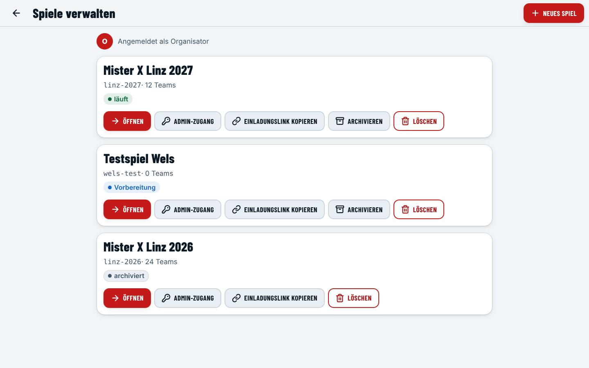
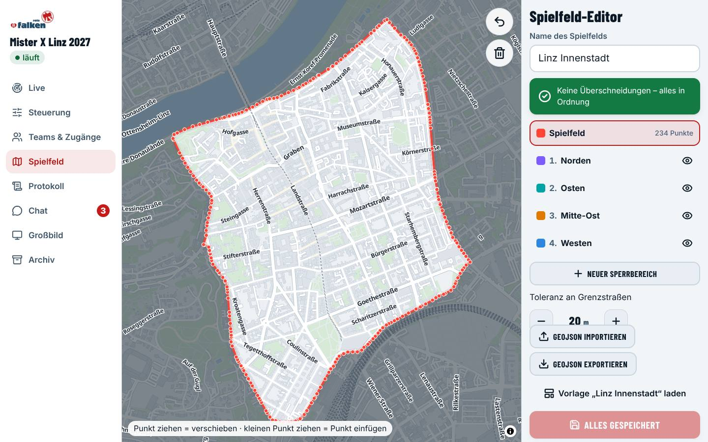
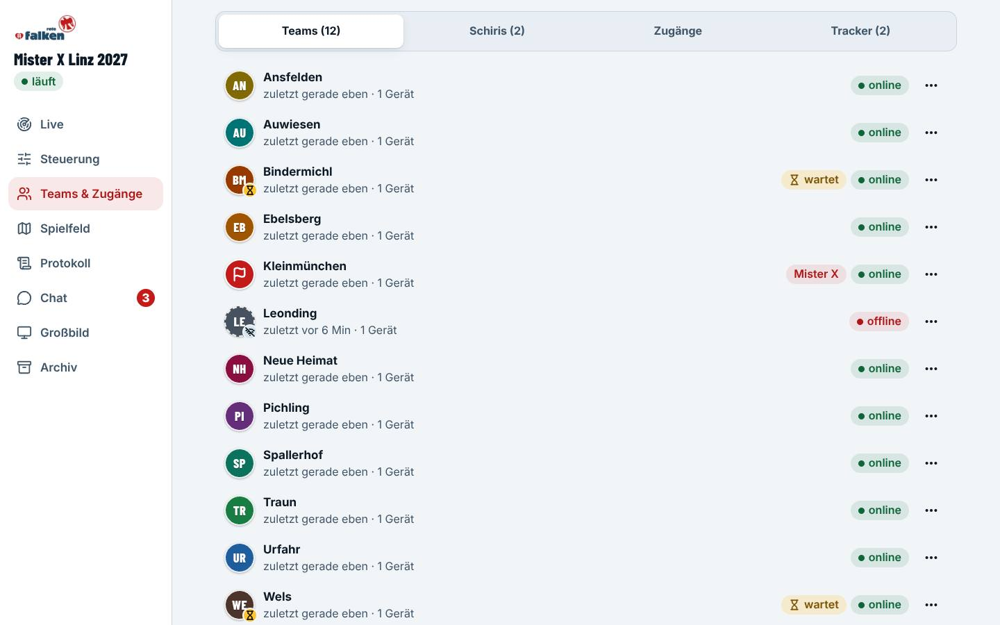
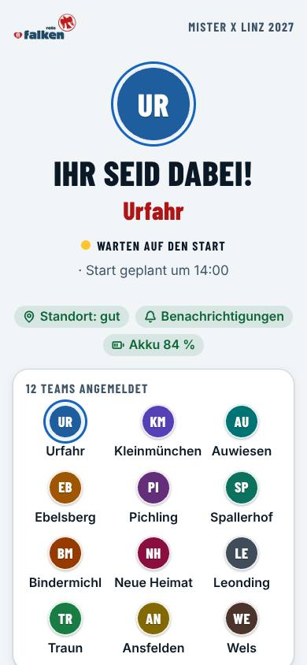
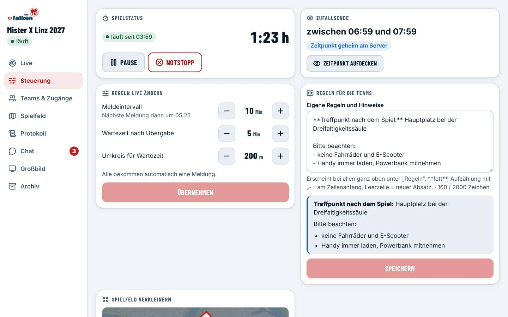
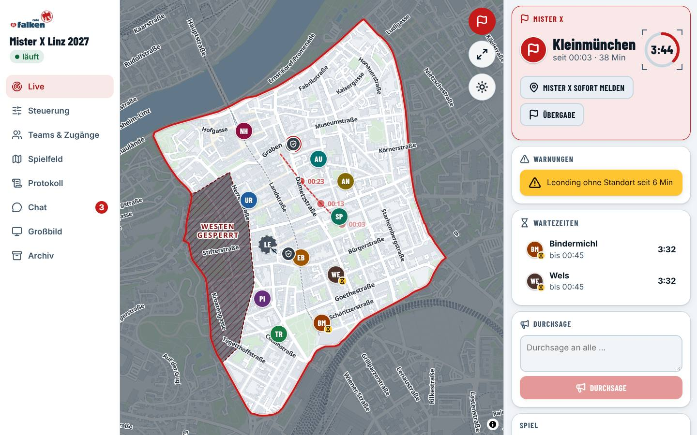
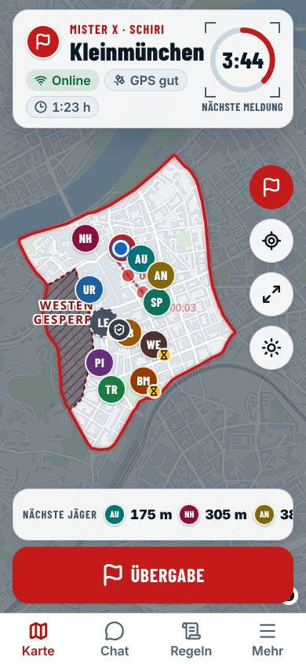
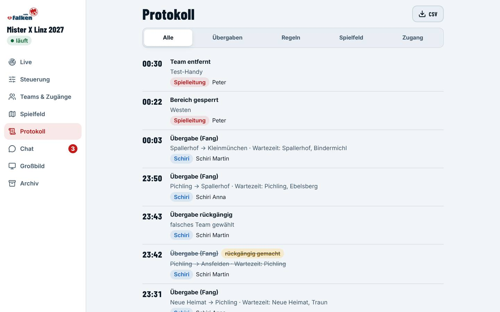
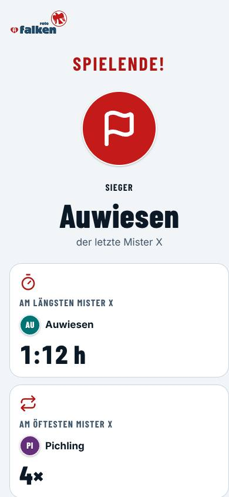
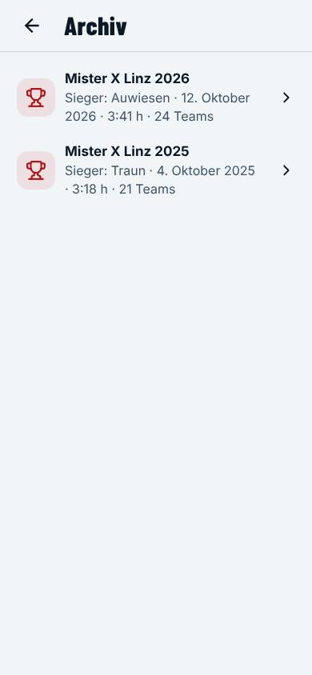

# Handbuch für die Spielleitung

Für alle, die ein Mister-X-Spiel vorbereiten und leiten – **ohne Programmierkenntnisse**. Die Einrichtung des Servers
(einmalig, durch den Organisator) steht in [`BETRIEB.md`](BETRIEB.md). Die Anleitung für die Teams steht in
[`TEAM-ANLEITUNG.md`](TEAM-ANLEITUNG.md), den Flyer druckst du direkt aus der App (Schritt 1.4).

Die Adresse der App ist im Folgenden `https://mister-x.mr-x-ooe.workers.dev` – bei einer eigenen Domain entsprechend
ersetzen. Alle Bilder: [`docs/screens/`](screens/) (hell, dunkel und Sonnen-Modus).

**Wer macht was?**

| Rolle | Gerät | Aufgabe |
|---|---|---|
| **Organisator** | Laptop | legt Spiele an, vergibt das Admin-Passwort, kann jedes Spiel öffnen (`#/verwaltung`) |
| **Spielleitung** | Laptop (oder Handy) | bereitet das Spiel vor, startet, steuert, beobachtet, beendet |
| **Schiri** | Handy | begleitet Mister X, trägt Übergaben ein, sieht alle Teams auf der Karte |
| **Team** | 1–2 Handys pro Team | spielt: jagt Mister X oder ist Mister X |
| **Großbild** | Laptop am Beamer | zeigt Karte, Countdown, Rangliste, Ereignisse in der Zentrale |
| **Zuschauer** | Handy (z. B. Eltern) | sieht Mister X, Meldungen und Rangliste – **keine** Standorte der Jäger |

---

## 1. Vor dem Spieltag

### 1.1 Spiel anlegen (Organisator)

1. `https://mister-x.mr-x-ooe.workers.dev/#/verwaltung` öffnen und mit dem **Organisator-Passwort** anmelden.
2. **Neues Spiel** → Name (z. B. „Mister X Linz 2027“), Spiel-Code (wird vorgeschlagen, z. B. `linz-2027`),
   Vorlage **Linz Innenstadt**, **Admin-Passwort** für die Spielleitung (mindestens 8 Zeichen) → **Anlegen**.
3. Das Admin-Passwort an die Spielleitung weitergeben (nicht per Gruppenchat mit Kindern!).

### 1.2 Als Spielleitung anmelden

1. Startseite der App → **Spielleitung** → Spiel-Code, dein Name, Admin-Passwort → **Anmelden**.
   (Der Organisator kommt aus der Verwaltung mit **Öffnen** direkt hinein.)
2. Links (am Handy unten) ist das Menü: **Live, Steuerung, Teams & Zugänge, Spielfeld, Protokoll, Chat, Großbild,
   Archiv**. Das Gerät bleibt 7 Tage angemeldet.

### 1.3 Spielfeld prüfen

**Spielfeld** öffnen. Die Vorlage „Linz Innenstadt“ enthält das Spielfeld und die Sperrbereiche zum Verkleinern
(Norden, Süden …). Du kannst

- Punkte der roten Grenze **ziehen** (verschieben) oder den kleinen Punkt zwischen zwei Punkten ziehen (einfügen),
- **Sperrbereiche** anlegen, umbenennen, einfärben und ihre **Reihenfolge** festlegen,
- die **Toleranz an Grenzstraßen** einstellen (die Grenzstraßen gehören noch zum Spielfeld),
- ein Spielfeld als **GeoJSON** exportieren und in einem anderen Spiel wieder importieren.

Unten steht, ob alles in Ordnung ist (z. B. „Die Linie kreuzt sich selbst“). **Speichern** – der Server prüft noch
einmal. Nach dem Start lässt sich das Spielfeld nicht mehr ändern; verkleinert wird dann unter **Steuerung**.

### 1.4 Zugänge festlegen und Blätter drucken

**Teams & Zugänge → Zugänge**:

1. **Team-Passwort** festlegen (für alle Teams gleich, z. B. `falke27`) → **Speichern**.
2. **Schiri-Code** festlegen (nur für Schiris) → **Speichern**.
3. Passwörter werden nur verschlüsselt gespeichert und können **nicht** wieder angezeigt werden – notieren oder bei
   Bedarf neu festlegen. Bereits angemeldete Geräte bleiben angemeldet.
4. **Druckblätter:** drei A4-Blätter – für **Teams**, **Schiris** und die **Spielleitung** – mit QR-Code (führt
   zur richtigen Anmeldung, Spiel-Code schon ausgefüllt), Spiel-Code, Passwort bzw. Code, Notfall-Telefon und einer
   kurzen Anleitung. Ein Passwort, das du gerade festgelegt hast, wird automatisch mitgedruckt; sonst fragt die App
   beim Drucken danach und prüft, ob es stimmt. Gespeichert wird es dafür nirgends – nur auf dem Papier.
   Das Blatt für die Spielleitung ist **vertraulich** (nicht aushängen, nach dem Spiel vernichten).
5. **Großbild-Link** nur auf dem Laptop für den Beamer öffnen (der Link enthält einen Schlüssel).

### 1.5 Regeln einstellen

**Steuerung → Regeln live ändern**: Meldeintervall (Standard **10 Min**), Vorsprung am Start (**10 Min**), Wartezeit
nach Übergabe (**5 Min**), Umkreis für die Wartezeit (**200 m**), Zufallsende (zwischen **3 und 4 Stunden**).
Alles lässt sich auch während des Spiels ändern; alle bekommen dann automatisch eine Meldung.

**Steuerung → Regeln für die Teams**: eigene Regeln und Hinweise für dieses Spiel, z. B. Treffpunkt nach dem Spiel,
Notfallnummer, „keine E-Scooter“. Die Teams sehen sie ganz oben im Tab **Regeln**. Einfache Formatierung:

- Leerzeile = neuer Absatz
- Zeile mit `- ` am Anfang = Aufzählungspunkt
- `**Wort**` = **fett**

Darunter zeigt eine Vorschau, wie es auf den Handys aussieht. Erst **Speichern** übernimmt den Text; ändert ihr ihn
während des Spiels, bekommen alle eine Meldung. Feld leeren und speichern = keine eigenen Regeln.

### 1.6 Tracker (optional)

Ein GPS-Tracker oder ein altes Handy mit der kostenlosen App **Traccar Client** kann in der Fahne stecken (dann kommt
der Standort von Mister X immer von dort) oder ein Team-Handy ersetzen: **Teams & Zugänge → Tracker → Tracker
hinzufügen**, zuordnen (Fahne oder Team) und die angezeigte **Geräte-Kennung** und **Server-Adresse** in Traccar
eintragen. Details: [`API.md`](API.md) Abschnitt 5a.

### 1.7 Probelauf

Spätestens eine Woche vorher mit 3–5 Handys in der Innenstadt testen: [`FELDTEST.md`](FELDTEST.md).

---

## 2. Am Spieltag – vor dem Start

1. **Treffpunkt:** Flyer austeilen. Jedes Team scannt den QR-Code, gibt seinen **Teamnamen** und das
   **Team-Passwort** ein. Ein zweites Handy desselben Teams tippt bei „Team gibt es schon“ auf
   **Als Ersatzgerät beitreten**.
2. Die Teams gehen das kurze **Onboarding** durch: Standort erlauben, Benachrichtigungen erlauben, Akku-Hinweise.
3. **Schiris** melden sich über **Ich bin Schiri** mit dem Schiri-Code an. Wer Mister X begleitet, schaltet unter
   **Mehr → Ich begleite Mister X** ein (dann gilt sein Standort, falls das Mister-X-Handy keinen schickt).
4. **Großbild:** Laptop am Beamer, Großbild-Link öffnen (oder als Spielleitung im Menü **Großbild**).
5. Unter **Live** siehst du, welche Teams angemeldet sind und ob ihr Standort ankommt
   („… hat noch keinen Standort geschickt“ = Handy prüfen lassen).

## 3. Spiel starten

**Steuerung → Start-Mister-X**: ein Team wählen **oder auslosen** → **Spiel starten** → bestätigen.

- Alle Handys zeigen einen Countdown 3-2-1, dann beginnt das Spiel.
- Mister X läuft los; die Jäger sehen die **Wartezeit** (Vorsprung).
- Nach dem Vorsprung meldet der Server den Standort von Mister X – danach alle eingestellten Minuten von selbst.
- Das **Spielende** liegt zufällig zwischen den eingestellten Zeiten und ist geheim. Unter **Steuerung → Zufallsende**
  kannst du es aufdecken (wird im Protokoll vermerkt, Teams sehen es nicht).

**Wichtig:** Meldungen, Wartezeiten und das Spielende macht der **Server** – auch wenn dein Laptop zu ist oder das
Netz weg ist.

## 4. Während des Spiels

### 4.1 Live-Übersicht

**Live** zeigt die Karte mit allen Teams, Mister X mit Spur, Schiris, die nächste Meldung und **Warnungen**, z. B.:

| Warnung | was tun |
|---|---|
| „Mister X ohne Standort seit … Min“ | Mister X anrufen; ein Schiri mit „Ich begleite Mister X“ springt automatisch ein |
| „Mister X … m vor der Spielfeldgrenze“ / „außerhalb des Spielfelds!“ | Mister X sieht die Warnung selbst; ggf. anrufen |
| „… ohne Standort seit … Min“ | Handy des Teams prüfen lassen (Akku, Standort erlaubt, App offen) |

Rechts daneben: **Durchsage** an alle (erscheint groß auf allen Handys und dem Großbild) und **Mister X sofort melden**
(z. B. als Strafe).

### 4.2 Übergabe (Fang)

Die Übergabe tragen in der Regel die **Schiris** am Handy ein: **Übergabe** → das fangende Team (das nächste steht
oben) → Vorschau, wer warten muss → **Fahne an … übergeben** → bestätigen.

- Das fangende Team wird Mister X, die alte Mister-X-Gruppe und alle Teams im Umkreis warten (Standard 5 Min).
- Ein Fehler? **Rückgängig** (2 Minuten lang) stellt alles wieder her – alle bekommen eine Erklärung.
- Doppelt tippen ist ungefährlich: der Server trägt jede Übergabe nur einmal ein.
- **Ohne Schiri:** Unter **Steuerung → Übergabe durch Teams** gibst du einzelne Teams frei. Ist so ein Team Mister X
  und wird gefangen, tippt es selbst **„Wir wurden gefangen“**, wählt das fangende Team und bestätigt. Strafübergaben
  und **Rückgängig** bleiben bei Schiris und Spielleitung.
- **Übergabe prüfen:** Waren die Handys der beiden Teams bei so einer selbst gemeldeten Übergabe mehr als ca. 150 m
  auseinander (plus GPS-Ungenauigkeit) oder fehlte ein aktueller Standort, gilt die Übergabe trotzdem – aber du und die
  Schiris bekommen „Übergabe prüfen“ (Benachrichtigung und rote Warnung in der Live-Übersicht, 30 Minuten lang). Kurz
  bei den Teams nachfragen und notfalls **Rückgängig** machen.

### 4.3 Spielfeld verkleinern

**Steuerung → Spielfeld verkleinern** → beim Bereich **Sperren** → bestätigen. Alle Handys zeigen „… wird gesperrt!“,
der Bereich ist auf allen Karten schraffiert. **Freigeben** macht es rückgängig.

### 4.4 Teams

**Teams & Zugänge → Teams**: pro Team **Wartezeit geben/aufheben**, **Umbenennen**, **Entfernen** (das Handy wird
abgemeldet). Unter **Schiris** siehst du, wer Mister X begleitet.

### 4.5 Chat und Postfach

**Chat**: Gruppenchat für alle. Im **Postfach** schreiben dir Teams direkt (z. B. „Akku leer“); deine Antwort sieht nur
dieses Team. Unpassende Nachrichten kannst du löschen.

### 4.6 Pause und Notstopp

- **Pause** (z. B. Regen): Meldungen, Wartezeiten und das Spielende stehen still; **Fortsetzen** macht weiter.
- **Notstopp** beendet das Spiel sofort; der aktuelle Mister X gewinnt.

### 4.7 Protokoll

**Protokoll** zeigt, wer wann was ausgelöst hat (Start, Übergaben, Rückgängig, Regeln, Zugänge) – mit Filter.

## 5. Spielende

Zum geheimen Zeitpunkt (oder per Notstopp) endet das Spiel **automatisch**:

- Alle Handys und das Großbild zeigen die **Auswertung**: Sieger (wer zuletzt Mister X ist), wie lange jedes Team
  Mister X war, Übergaben, Strecke, Zeitstrahl.
- **Live-Standorte werden sofort gelöscht**, die Handys senden keinen Standort mehr.
- In der Steuerung führt **Auswertung ansehen** zur Auswertung.

## 6. Nach dem Spiel

1. **Archiv** (Menü): jeder Lauf mit Sieger. **Wiederholung** mit Zeitschieberegler (wer war wann Mister X, wo wurde
   gemeldet und gefangen), Chat-Verlauf, **Als Datei sichern** (JSON) und **Drucken**.
2. Für ein neues Spiel mit denselben Einstellungen: **Teams & Zugänge → Zugänge → Neue Runde vorbereiten**. Alle Teams
   und Schiris werden abgemeldet, das Team-Passwort wird gelöscht, Chat und Standorte werden geleert. Das Archiv
   bleibt. Danach ein neues Team-Passwort festlegen (Schritt 1.4).
3. Fertig mit der Saison? Der Organisator kann das Spiel in der Verwaltung **archivieren** (niemand kann mehr
   beitreten) oder **löschen** (alles weg, auch das Archiv).

**Löschfristen** (automatisch): Live-Standorte sofort bei Spielende, Chat nach 30 Tagen, Archiv nach einem Jahr.

## 7. Hilfe bei Problemen

| Problem | Lösung |
|---|---|
| Team kann nicht beitreten: „Noch kein Team-Passwort festgelegt“ | Schritt 1.4 |
| „Das Passwort stimmt nicht“ | Groß-/Kleinschreibung prüfen; notfalls neues Team-Passwort festlegen |
| „Zu viele Versuche“ | 10 Minuten warten (Schutz gegen Passwort-Raten) |
| Team-Handy kaputt / Akku leer | anderes Handy mit gleichem Teamnamen → **Als Ersatzgerät beitreten** |
| Standort eines Teams kommt nicht an | App offen lassen (iPhone/Browser) bzw. Android-App mit Akku-Optimierung aus; Standort erlaubt? |
| Mister X hat kein Netz | Ein Schiri schaltet „Ich begleite Mister X“ ein – dann gilt sein Standort |
| Übergabe falsch eingetragen | **Rückgängig** innerhalb von 2 Minuten (Schiri oder Spielleitung) |
| Laptop der Spielleitung fällt aus | Egal: der Server spielt weiter. Auf einem anderen Gerät wieder als Spielleitung anmelden |
| App zeigt „Neue Version – bitte neu laden“ | einmal neu laden; man bleibt angemeldet |
| Benachrichtigungen kommen nicht (iPhone) | nur als Web-App vom Home-Bildschirm (ab iOS 16.4) und wenn erlaubt |

Technische Probleme mit dem Server: [`BETRIEB.md`](BETRIEB.md) Abschnitt 15.
