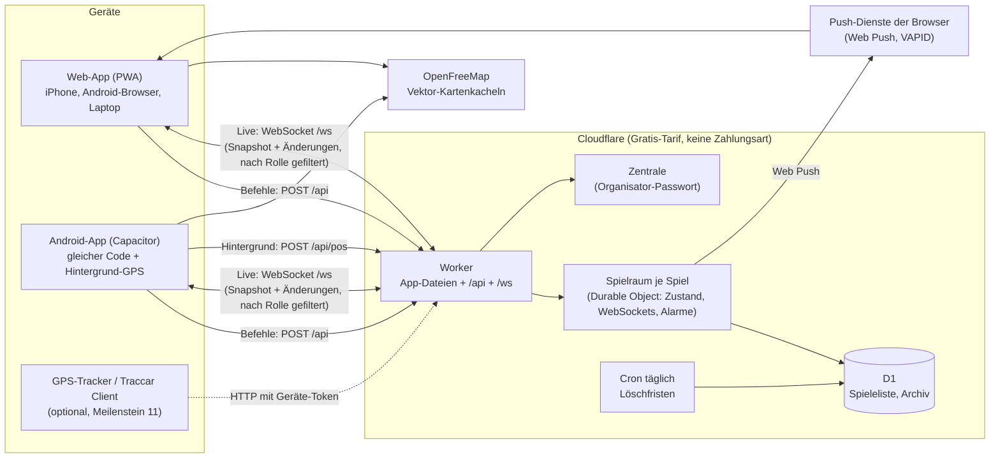
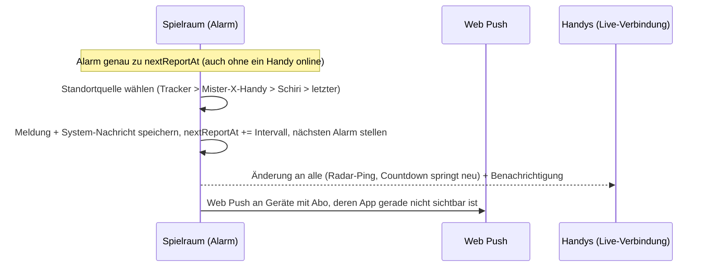
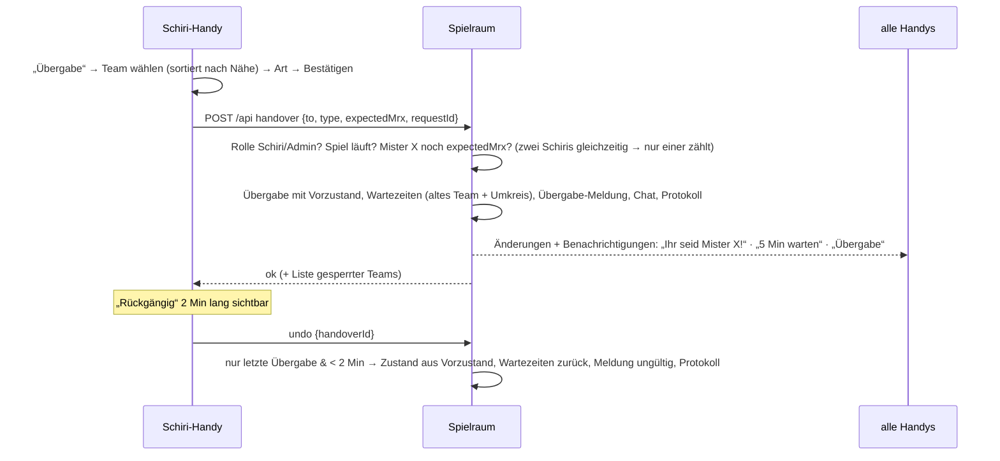
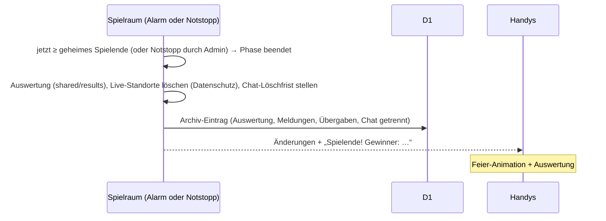

# Konzept: „Mister X“

Stand: Meilenstein 1 (Analyse & Konzept) + Design-Prototyp – **vom Organisator bestätigt am 27.10.2026**
(alle Vorschläge aus Abschnitt 9 angenommen, siehe E-20). **Aktualisiert in Meilenstein 9b:** Der Server läuft jetzt bei
**Cloudflare** statt Firebase (E-32 bis E-38); Architektur, Datenhaltung, Abläufe und Kosten unten entsprechend.
Schnittstelle: [`API.md`](API.md), Betrieb: [`BETRIEB.md`](BETRIEB.md), Limits: [`CLOUDFLARE-LIMITS.md`](CLOUDFLARE-LIMITS.md).
Begründungen zu allen Entscheidungen: [`ENTSCHEIDUNGEN.md`](ENTSCHEIDUNGEN.md). Offene Fragen: [Abschnitt 9](#9-offene-fragen-bitte-beantworten).

---

## 1. Was der Prototyp lehrt (Analyse des Ist-Stands)

| Thema | Prototyp (`app.js`, 540 Zeilen) | Problem | Neubau |
|---|---|---|---|
| Spiel-Logik | läuft im Browser (`tick()` jede Sekunde, Transaktion auf `reports/{slot}`) | Sind Admin- und Mister-X-Handy offline, passiert nichts. Zufallsende nur, wenn Admin-Handy offen ist. | **Server-Autorität**: ein Spielraum pro Spiel (Cloudflare Durable Object) mit Alarmen |
| Geheimnisse | `secret/teamPw` im Klartext, Admin liest es; Admin-Konto = „wer zuerst kommt“ | Passwort im Klartext, Admin-Übernahme beim ersten Aufruf möglich | Passwörter **gehasht** (PBKDF2), nur der Server kennt sie; Organisator mit eigenem Passwort (Setup-Geheimnis) |
| Rechte | Rules prüfen Rolle, aber `game`, `handovers`, `locks` sind für **jeden Schiri** frei beschreibbar | Ein Schiri-Handy kann das Spiel beliebig verändern | Spielzustand ändert **nur** der Server; Geräte senden Befehle |
| Standort | `watchPosition` nur bei offenem Bildschirm, alle 15 m / 30 s | Hintergrund unmöglich | Android-App mit Foreground-Service; Web wie bisher + Wake Lock |
| Distanz | Handy zählt selbst und schreibt `stats/dist` | manipulierbar, GPS-Sprünge zählen mit | Server zählt aus aufeinanderfolgenden Punkten (Plausibilität) |
| Spielfeld | fest in `zones.js`, Toleranz über 8 Prüfpunkte | nur Linz, Näherung bis 1,5 m | Spielfeld pro Spiel in der Datenbank, Toleranz auf 0,4 m genau, exakter Abstand zur Grenze für Warnungen; **Linz-Polygone 1:1 übernommen** |
| Schiris | melden sich als Team an, Admin befördert | umständlich, Schiri erscheint kurz als Team | eigener **Schiri-Code** |
| Benachrichtigung | Ton + Vibration nur bei offener Seite | nichts bei gesperrtem Handy | Web Push (PWA) bzw. lokale Benachrichtigungen (Android-App) + In-App-Ton |

**Übernommen werden die Abläufe**, die sich bewährt haben: Team-Login mit gemeinsamem Team-Passwort, Übergabe mit
Umkreis-Wartezeit, Rückgängig, Strafübergabe, Sofort-Meldung, Durchsage, Offline-Warnung nach 3 Min, Zufallsende-Fenster,
Notstopp, Auswertung (4 Kategorien), Archiv mit Mister-X-Route + Chat, „Neue Runde vorbereiten“, Großbild.
Die E2E-Szenarien aus `test/e2e.js` und die Zonen-Prüfpunkte aus `test/zones.test.mjs` werden 1:1 als Testfälle weitergeführt.

---

## 2. Architektur im Überblick



**Grundprinzip:** Jedes Spiel hat **einen Spielraum** – die einzige Stelle, die den Spielzustand ändert. Geräte senden
**Befehle** („Übergabe an Team B“); der Spielraum prüft Rolle, Zustand und Zeit und führt sie aus oder lehnt sie ab.
Über eine **Live-Verbindung** bekommt jedes Gerät genau das, was seine Rolle sehen darf, und schickt seinen Standort.
Meldungen, Wartezeiten und das Spielende löst der Spielraum per **Alarm** selbst aus – auch wenn kein Handy online ist.

### 2.1 Bausteine

| Baustein | Technik | Aufgabe |
|---|---|---|
| **App** | TypeScript (strict), Svelte 5, Vite, MapLibre GL, PWA (Service Worker) | Eine Codebasis für Web und Android |
| **Android-Hülle** | Capacitor 8, `@capacitor-community/background-geolocation`, `@capacitor/local-notifications` | Hintergrund-Standort mit Dauer-Benachrichtigung, lokale Benachrichtigungen |
| **Worker** | Cloudflare Worker mit Static Assets (`server/src/index.ts`) | liefert die App aus, prüft Tokens, leitet Befehle und Verbindungen an den Spielraum |
| **Spielraum** | Durable Object mit SQLite-Speicher, WebSocket-Hibernation, Alarm (`server/src/room.ts`) | Zustand, Regeln, Rechte, Live-Verteilung, Zeitsteuerung, Web Push |
| **Datenbank** | D1 (`server/src/d1.ts`) | Spieleliste der Verwaltung, Archiv (mit Löschfristen) |
| **Login** | eigene Sitzungs-Tokens (HMAC), Passwörter mit PBKDF2; Organisator mit Setup-Geheimnis + Passwort | keine E-Mail-Konten, kein Google-Konto nötig |
| **Push** | Web Push mit VAPID (Browser, iPhone-Web-App ab iOS 16.4); Android-App: lokale Benachrichtigungen aus der Verbindung | Meldung, Übergabe, Wartezeit, Durchsage … |
| **Karte** | MapLibre GL + OpenFreeMap-Vektorkacheln, **eigener Kartenstil** (hell/dunkel/Sonne) | kostenlos, ohne Schlüssel, ohne Tracking; Fallback OSM-Raster |
| **Gemeinsamer Code** | `shared/` – reine TypeScript-Module | Meldeplan, Geometrie/Zonen, Wartezeit-Umkreis, Standortquellen, Auswertung, Push-Empfänger, Typen, Protokoll, Client-Bibliothek. Von App **und** Server genutzt, mit Unit-Tests |

### 2.2 Ordnerstruktur (Monorepo mit npm-Workspaces)

```
shared/      reine Spiel-Logik, Typen, Vertrag (api.ts, protocol.ts), Client-Bibliothek, Linz-Vorlage
app/         Svelte-App (Web + Android via Capacitor, Ordner app/android/)
  src/ui/        Komponenten-Bibliothek (Design-System)
  src/screens/   die 23 Screens
  src/map/       Karte + Kartenstile
  src/lib/       Sitzung, Live-Daten, Standort, Push, Ton, Zeit
  src/texte.ts   alle Texte zentral
server/      Cloudflare Worker + Spielraum + Zentrale (wrangler.jsonc)
tests/       Server-, Rechte-, Ruhezustand- und E2E-Tests gegen die lokale Cloudflare-Laufzeit (Playwright)
docs/        Konzept, Entscheidungen, API, Betrieb, Limits, Handbücher, Screenshots
promo/       Videos, Screenshots und ihre Quellen
```

---

## 3. Rollen, Zugang, Rechte

### 3.1 Wie man in ein Spiel kommt

| Rolle | Zugang | Technisch |
|---|---|---|
| **Super-Admin** (Organisator) | Organisator-Passwort (einmalig mit dem **Setup-Geheimnis** festgelegt) | Zentrale prüft den PBKDF2-Hash → Organisator-Token mit Passwort-Version |
| **Spiel-Admin** | Spiel-Code + Name + **Admin-Passwort** (vom Super-Admin pro Spiel vergeben) | Spielraum prüft den Hash → Mitglied `admin` + Sitzungs-Token |
| **Schiri** | Spiel-Code + Name + **Schiri-Code** | wie oben, Rolle `schiri` |
| **Team** | QR-Code/Link (enthält Spiel-Code) + Teamname + **Team-Passwort** | wie oben, Rolle `team`; ein zweites Handy kann demselben Team beitreten (Ersatzgerät) |
| **Großbild** | Link mit Großbild-Schlüssel (Admin zeigt QR) | Rolle `screen`: sieht alles wie Admin, darf nichts ändern |
| **Zuschauer** (optional, pro Spiel einschaltbar) | öffentlicher Zuschauer-Link | Rolle `viewer`: nur Mister-X-Meldungen + Ereignisse, **keine** Live-Positionen, kein Chat |

Die Mitgliederliste führt **ausschließlich** der Spielraum; aus ihr kommt die Rolle jedes Geräts.
Mehrere Spiel-Admins pro Spiel sind möglich (jeder mit eigenem Namen → im Protokoll nachvollziehbar).
Fehlversuche beim Beitritt werden pro IP und Spiel gezählt (max. 20 in 10 Min, großzügig wegen Mobilfunk-NAT).

### 3.2 Rechte-Matrix (durchgesetzt im Spielraum, automatisiert getestet inkl. Angriffsversuchen)

| Daten / Aktion | Team | Mister-X-Team | Schiri | Spiel-Admin | Großbild | Zuschauer | Super-Admin |
|---|---|---|---|---|---|---|---|
| Spielzustand, Meldungen, Übergaben, Wartezeiten lesen | ✔ | ✔ | ✔ | ✔ | ✔ | ✔ | ✔ |
| **Live-Positionen** (`pos`, `staffPos`, `trackerPos`) lesen | ✖ | ✖ | ✔ | ✔ | ✔ | ✖ | ✔ |
| eigenen Standort schreiben | ✔ (nur eigenes Team) | ✔ | ✔ | optional | – | – | – |
| Gruppenchat lesen/schreiben | ✔ / ✔ | ✔ / ✔ | ✔ / ✔ | ✔ / ✔ | ✔ / ✖ | ✖ | ✔ |
| Direktkanal | nur eigener | nur eigener | ✖ | alle | ✖ | ✖ | alle |
| System-Meldung / Durchsage erzeugen | ✖ | ✖ | ✖ | Durchsage ✔ | ✖ | ✖ | ✔ |
| Übergabe, Strafübergabe, Rückgängig, Wartezeit setzen | ✖ | ✖ | ✔ | ✔ | ✖ | ✖ | ✔ |
| Start, Pause, Notstopp, Regeln, Sperrbereiche, Zufallsende aufdecken | ✖ | ✖ | ✖ | ✔ | ✖ | ✖ | ✔ |
| Passwörter/Codes, Teams & Schiris verwalten, Neue Runde, Protokoll lesen | ✖ | ✖ | ✖ | ✔ | ✖ | ✖ | ✔ |
| Spiele anlegen/archivieren/löschen, Spiel-Admin-Passwort | ✖ | ✖ | ✖ | ✖ | ✖ | ✖ | ✔ |

Gefiltert wird **jede** Nachricht pro Verbindung, bevor sie rausgeht – Teams bekommen fremde Positionen nicht einmal
versteckt im Datenverkehr. `tests/rechte.test.ts` liest dafür den rohen Datenverkehr aller Rollen mit.

---

## 4. Datenmodell (Spielraum + D1)

Jedes Spiel ist ein Spielraum mit diesen Teilen (gespeichert je Teil im SQLite-Speicher des Durable Objects).
`{t}` = Team-ID, `{uid}` = Gerätekennung (vom Beitritt). Wer was sieht: siehe [`API.md`](API.md), Abschnitt 3.3.

| Teil | Inhalt | sieht |
|---|---|---|
| `info` | Name, Phase (`vorbereitung`, `laeuft`, `pause`, `beendet`), Zuschauer erlaubt?, archiviert? | alle Mitglieder |
| `config` | `intervalMin` (10), `headStartMin` (10), `waitMin` (5), `radiusM` (200), `undoMin` (2), `endMinH`/`endMaxH` (3/4) | alle |
| `field` | Spielfeld-Polygon, Toleranz, Sperrbereiche `{id: {name, kurz, farbe, reihenfolge, polygon}}` | alle |
| `state` | `mrx`, `mrxSince`, `startedAt`, `pausedAt`, `lastReportAt`, `nextReportAt`, `cuts`, `lastHandover`, `run`, `rev` | alle |
| `teams/{t}` | Name, Kürzel, Farbe | alle |
| `reports`, `handovers`, `locks`, `pauses`, `cutLog`, `stats` | Meldungen (mit Quelle/Art/`void`), Übergaben (mit Vorzustand für Rückgängig), Wartezeiten, Pausen, Verkleinerungen, Strecke je Team | alle |
| `chat`, `dm/{t}` | Gruppenchat (`msg`/`sys`/`ann`), Direktkanal Team ↔ Spielleitung | Chat: alle außer Zuschauer; Direktkanal: Team `{t}` + Spielleitung |
| `positions/{t}`, `staff/{uid}` | letzter Standort je Team bzw. Schiri (`lat, lng, acc, t, heading?, battery?, suspect?`) | **nur** Spielleitung, Schiri, Großbild |
| `members/{uid}`, `audit` | Geräte mit Rolle/Team/Name/`followsFlag`; Protokoll (wer, wann, was) | nur Spielleitung (jeder sieht seinen eigenen Eintrag als `me`) |
| `devices/{id}` | Tracker: Name, Zuordnung (`fahne` / Team / frei), letzter Standort | Spielleitung, Schiri, Großbild |
| `track/{t}` | letzter angenommener Punkt je Team für die Strecke | **niemand** |
| `push/{uid}` | Web-Push-Abo + gewünschte Arten | nur das Gerät selbst (`me.push`) |
| `secrets` | Passwort-Hashes (Admin/Schiri/Team), Großbild-Schlüssel, Tracker-Schlüssel, **geheimes Spielende** | **niemand** |
| `rate` | Fehlversuche beim Beitritt je IP (gehasht), nach 10 Min gelöscht | niemand |
| `purgeAt` | Löschfrist für Chat und Protokoll nach Spielende (30 Tage) | niemand |

**D1** (spielübergreifend): `games` (Spieleliste der Verwaltung: Name, Phase, Anzahl Teams, archiviert) und
`archive` (je beendetem Lauf: Auswertung, Meldungen, Übergaben, Verkleinerungen, Pausen, Spielfeld, Teamnamen;
Chat getrennt, damit er nach 30 Tagen gelöscht werden kann).

**Bewusst nicht gespeichert:** lückenlose Bewegungsprofile. Es gibt immer nur den **letzten** Standort pro Team; die
Strecke wird beim Eintreffen jedes Punkts aufsummiert, ohne die Spur zu speichern. Nur Mister-X-*Meldungen* (die ohnehin
alle gesehen haben) kommen ins Archiv. Bei Spielende werden alle Live-Standorte sofort gelöscht.

**Löschfristen** (im Server umgesetzt und getestet, Datenschutzhinweis in der App unter Regeln → Datenschutz):

| Was | Frist |
|---|---|
| Live-Standorte (Teams, Schiris, Tracker) | sofort bei Spielende |
| Chat, Direktnachrichten, Protokoll der Spielleitung | 30 Tage nach Spielende (bzw. sofort bei „Neue Runde“) |
| Archiv (Auswertung, Meldungen von Mister X, Übergaben, Teamnamen) | 1 Jahr (täglicher Cron) |
| Chat im Archiv | 30 Tage (täglicher Cron) |
| Prüfsumme der IP-Adresse nach falschem Passwort | 10 Minuten |
| Anmeldung auf dem Gerät (Sitzungs-Token) | 7 Tage, Abmelden/„Neue Runde“/Entfernen sofort |
| alles eines Spiels | „Löschen“ in der Verwaltung |

---

## 5. Spielregeln → Umsetzung (Server)

Die Nummern verweisen auf das Original-Regelblatt (`archiv/PROMPT-NEUBAU.md`, Abschnitt 1). Alle Zeiten sind **Server-Zeit**;
die Handys rechnen ihren Countdown mit der Server-Zeit, die in jeder Nachricht der Live-Verbindung steht.

| # | Regel | Umsetzung |
|---|---|---|
| 1, 2 | Mister X startet zuerst, nach 10 Min Meldung, dann laufen alle los | Start: `mrx` gesetzt, **Startsperre** (`locks`) für alle Jäger bis `startedAt + headStartMin`; erste Meldung genau dann |
| 3, 4 | Tapperl → Übergabe; altes Team + Teams in der Nähe warten 5 Min | Befehl `handover` (nur Schiri/Admin). Übergabeort = Standort des neuen Mister X (Fallback: alter Mister X, Schiri). Gesperrt: altes Team + alle Teams mit **frischem** Standort im Umkreis `radiusM`; der neue Mister X nie. Sofort eine Meldung („Übergabe-Meldung“), nächste automatische Meldung nach `intervalMin` |
| 5 | Meldung alle 10 (später 5) Min | `nextReportAt = lastReportAt + intervalMin`. Bei Intervalländerung: `max(lastReportAt + neu, jetzt + 1 Min)` → Mister X hat immer mind. 1 Min Vorwarnung |
| 7, 9 | nicht in Gebäuden / Grenzstraßen gehören dazu | Spielfeld mit Toleranz (`toleranceM`, Standard 20 m; Prüfung über 32 Punkte im Kreis, auf 0,4 m genau). Abstand zur Grenze für die Mister-X-Warnung exakt. Gebäude prüft die App nicht (Schiri) |
| 10 | Verkleinerung | Befehl `setCut` → Bereich gesperrt, System-Meldung + Push „Der Norden wird gesperrt!“ |
| 11, 13 | Schiri/Admin entscheidet, Strafübergabe | Befehl `handover` mit `type: strafe`; Spielfeld-Warnung geht an Mister X + Schiri + Admin, Konsequenz entscheidet der Mensch |
| 12 | Wer am Ende Mister X ist, gewinnt | Zufallszeitpunkt gleichverteilt in `[Start + endMinH, Start + endMaxH]`, nur in `secrets` gespeichert; der Alarm des Spielraums beendet das Spiel |
| – | Rückgängig | nur die **letzte** Übergabe, nur innerhalb `undoMin` (2 Min), stellt `mrx`, `mrxSince`, `nextReportAt` aus `prev` wieder her, entfernt die dadurch gesetzten Wartezeiten, markiert die Übergabe-Meldung als `void` |
| – | Sofort-Meldung (Strafe) | zusätzliche Meldung, Meldeplan läuft unverändert weiter |
| – | Pause (Vorschlag) | friert Meldeplan, Wartezeiten und Spielende ein; beim Fortsetzen werden alle Zeiten um die Pausendauer verschoben |

**Standortquelle für Meldungen und Umkreis** (eine gemeinsame Funktion in `shared/`, von Server und Karte genutzt):
1. Tracker, der „der Fahne“ zugeordnet ist (wenn jünger als 2 Min)
2. Mister-X-Gerät (jünger als 2 Min)
3. Schiri, der der Fahne folgt (jünger als 2 Min)
4. sonst der **letzte bekannte** Standort aus 1–3 → Meldung zeigt „letzter bekannter Standort von 14:32“

Jede Meldung speichert ihre Quelle; die App zeigt sie transparent an („Standort vom Schiri“).

**Plausibilität (beim Eintreffen jedes Standorts im Spielraum):** Punkte mit Genauigkeit > 50 m zählen nicht zur Distanz; Sprünge mit > 25 m/s
(90 km/h) werden als `suspect` markiert und weder für Distanz noch für Umkreis-Wartezeit verwendet; Bewegungen < 10 m
gelten als GPS-Rauschen.

---

## 6. Abläufe

### 6.1 Automatische Mister-X-Meldung



Der Spielraum macht eins nach dem anderen – zwei gleichzeitige Auslöser können nie doppelt melden.

### 6.2 Übergabe (Fang) und Rückgängig



Netzabbruch während der Übergabe: Die App wiederholt die Anfrage mit derselben Kennung; der Spielraum erkennt sie und
führt nichts doppelt aus.

### 6.3 Spielende



### 6.4 Beitritt per QR-Code

QR-Code → `https://mister-x.mr-x-ooe.workers.dev/#/s/linz-2027` → Startseite mit vorausgefülltem Spiel → Teamname +
Team-Passwort → Befehl `join` (liefert das Sitzungs-Token) → Onboarding (Standort, Benachrichtigungen, Akku, Regeln kurz) → Warteraum. Das Gerät merkt sich das Spiel;
wird das Team entfernt oder eine neue Runde vorbereitet, landet das Gerät mit einer freundlichen Erklärung auf der Startseite.

---

## 7. Standort, Akku, schlechtes Netz

- **Senderhythmus (adaptiv):** Mister X alle 10 s oder bei > 15 m Bewegung; Jäger und Schiris alle 15 s / > 15 m;
  vor Spielstart jede Minute; nach Spielende gar nicht. Punkte mit Genauigkeit > 100 m werden gekennzeichnet.
- **Android-App:** Foreground-Service mit Dauer-Benachrichtigung „Mister X läuft – Standort wird geteilt“,
  Berechtigungen `ACCESS_FINE_LOCATION`, `ACCESS_BACKGROUND_LOCATION`, `FOREGROUND_SERVICE_LOCATION`,
  `POST_NOTIFICATIONS`, Bitte um Ausnahme von der Akku-Optimierung (mit Schritt-für-Schritt-Hilfe im Onboarding).
- **iPhone (ehrlich):** Safari/PWA sendet **keinen** Standort, wenn der Bildschirm aus ist oder eine andere App offen ist.
  Lösung im Spiel: Bildschirm anlassen (Wake Lock), Powerbank. Push funktioniert nur, wenn die Web-App zum
  Home-Bildschirm hinzugefügt wurde (ab iOS 16.4). Für Mister X fängt der Schiri-Fallback Lücken auf.
- **Offline:** Die Live-Verbindung verbindet sich mit wachsender Pause selbst neu und holt dann einen frischen Snapshot;
  der neueste Standort wartet und geht danach raus. Die App zeigt „Offline – letzte Daten von 14:32“. Befehle werden bei
  Netzfehlern mit derselben Kennung wiederholt und nie doppelt ausgeführt. Die Kartenkacheln des Spielfelds werden beim Beitritt vorgeladen (≈ 30 Kacheln, erlaubt laut
  OpenFreeMap-Nutzungsbedingungen), damit die Karte auch in Unterführungen da ist.
- **Akku:** kein Dauer-Neuzeichnen (Svelte aktualisiert nur geänderte Stellen), Countdown-Animation per CSS,
  Karte zeichnet nur bei Datenänderung neu.

---

## 8. Kosten

**0 €.** Alles läuft im Cloudflare-Gratis-Tarif **ohne Zahlungsart**; ohne Zahlungsart kann nichts abgerechnet werden –
wird ein Tageslimit überschritten, schlagen Anfragen bis Mitternacht (UTC) fehl. Ein Spiel mit 30 Teams über 4 Stunden
braucht im schlimmsten Fall etwa ein Fünftel der Tageslimits. Rechnung und Quellen: [`CLOUDFLARE-LIMITS.md`](CLOUDFLARE-LIMITS.md).
Kartenkacheln (OpenFreeMap) sind kostenlos. Der Lasttest (Meilenstein 12) misst die Zahlen in der lokalen
Cloudflare-Laufzeit nach.

---

## 9. Offene Fragen

Zu jeder Frage steht der **Vorschlag**. Bestätigt am 27.10.2026: F2, F3, F6, F8, F10, F14 ausdrücklich, alle übrigen
als Standard. F1: PNG-Logos wie vorgeschlagen (Vektor-Dateien optional, öffentlich nicht verfügbar). F12 (Verantwortlicher
im Datenschutzhinweis) ist derzeit offen (E-62) und wird vor dem ersten echten Spiel eingetragen.

| # | Frage | Vorschlag |
|---|---|---|
| F1 | **Logos & Farben:** Welche Logos und Farben verwendet die App? | Eigenes Mister-X-Logo (E-61, E-62), Farben Mister-X-Rot `#C51A1A` und -Blau `#214C6B` |
| F2 | **Pause-Funktion** (z. B. Regen)? | **Ja**: friert Meldungen, Wartezeiten und Spielende ein |
| F3 | **Aufbewahrung** Archiv / Chat? | Archiv (Meldungen, Übergaben, Auswertung) **1 Jahr**, Chat **30 Tage**, Live-Standorte **sofort bei Spielende** gelöscht |
| F4 | Sehen sich **Jäger-Teams gegenseitig** auf der Karte? | **Nein** (wie bisher) |
| F5 | Sieht **Mister X die Jäger**? | **Nein** (wie bisher) |
| F6 | **Zuschauer-/Eltern-Modus**? Was darf er zeigen? | Ja, pro Spiel einschaltbar: nur Mister-X-Meldungen, Übergaben, Spielfeld, Rangliste – **keine** Live-Positionen, kein Chat |
| F7 | Wer ist **Super-Admin**? Wie viele Spiel-Admins? | Super-Admin: der Organisator (Konto `mr.x.rf.ooe@gmail.com` bei Cloudflare; in der App eigenes Organisator-Passwort, E-33). Beliebig viele Spiel-Admins über das Admin-Passwort, jeder mit Namen |
| F8 | Soll der Start-Mister-X **ausgelost** werden können? | **Ja**, mit Los-Animation; alternativ direkt wählen |
| F9 | **Vorsprung am Start** = Meldeintervall oder eigener Wert? | eigener Wert `headStartMin`, Standard 10 Min |
| F10 | Nach einer Übergabe **sofort** den Standort des neuen Mister X melden? (`archiv/SPEC.md`: ja) | **Ja**, Übergabe-Meldung am Übergabeort |
| F11 | **Umkreis** für die Wartezeit nach Übergabe? | 200 m (wie Prototyp), live änderbar |
| F12 | **Datenschutz:** Wer ist „Verantwortlicher“ (Name, Adresse, Kontakt-E-Mail) für den Datenschutzhinweis? | Offen – vor dem ersten echten Spiel eintragen (E-62) |
| F13 | **APK-Verteilung:** Das Repository ist privat → GitHub-Downloads brauchen ein Konto. | APK über die eigene Adresse ausliefern (`https://mister-x.mr-x-ooe.workers.dev/mister-x.apk`, E-38) + QR-Code |
| F14 | Darf ein Team ein **zweites Handy** (Ersatzgerät) anmelden? | **Ja**, gleiches Team-Passwort; das jeweils neueste Signal zählt |

---

## 10. Design-Konzept (Kurzfassung – Details im Klick-Prototyp)

**Leitidee „Fahndung in Rot-Weiß“:** dunkles Nacht-Blau als Spielfläche, kräftiges
Rot für alles, was mit Mister X und Aktionen zu tun hat, Weiß für Lesbarkeit. Agenten-Elemente sparsam:
schmale, fette Großbuchstaben-Überschriften (wie Akten-Stempel), Radar-Ping bei Meldungen, gestrichelte Spur,
Ecken-Markierungen wie ein Fadenkreuz am Countdown. Wärme: runde Formen, Fahne + Falke, freundliche
Sprache („Tapperl“, „Ihr seid Mister X!“).

- **Drei Darstellungen:** *Dunkel* (Standard im Spiel), *Hell*, **Sonne** (Hochkontrast: weißer Grund, schwarze Schrift,
  dicke Ränder, keine Transparenzen) – automatisch nach System, im Spiel mit einem Tipp umschaltbar.
- **Mister-X-Modus:** Rahmen + Statusleiste wechseln auf Rot, Fahnen-Symbol – sofort erkennbar, auch aus dem Augenwinkel.
- **Typografie:** *Barlow Condensed* (Überschriften, Countdown, tabellarische Ziffern) + *Inter* (Text), lokal
  eingebunden, Mindestgröße 16 px; Countdown 48–96 px.
- **Bedienung:** Touch-Ziele ≥ 48 px (wichtige ≥ 56 px), Hauptaktionen unten in der Daumenzone, gefährliche Aktionen
  rot umrandet + Bestätigung; Untere Navigation **Karte · Chat · Regeln · Mehr**.
- **Karte:** eigener MapLibre-Stil auf OpenFreeMap-Kacheln: gedämpfte Basiskarte, außerhalb des Spielfelds abgedunkelt,
  leuchtend rote Grenzlinie, gesperrte Bereiche schraffiert mit Namen, Straßennamen groß und kontrastreich.
- **Barrierefreiheit:** WCAG AA (Statusleiste AAA), nie Information nur über Farbe (immer Icon + Text),
  „Bewegung reduzieren“ wird respektiert.

Der **Klick-Prototyp** (Meilenstein 2) zeigt alle 23 Screens mit Testdaten in hell/dunkel/Sonne und ist bereits im
echten Technik-Stack gebaut – die Komponenten werden später direkt weiterverwendet.

---

## 11. Weiterer Plan

Nach Bestätigung von Konzept + Prototyp geht es in der Reihenfolge der Meilensteine 3–13 aus `archiv/PROMPT-NEUBAU.md` weiter.
Jeder Meilenstein endet lauffähig, getestet, committet und mit kurzem Bericht im Pull Request.
