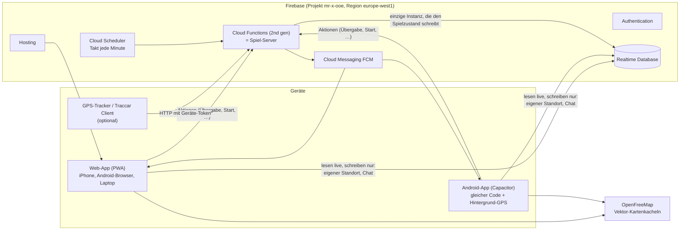
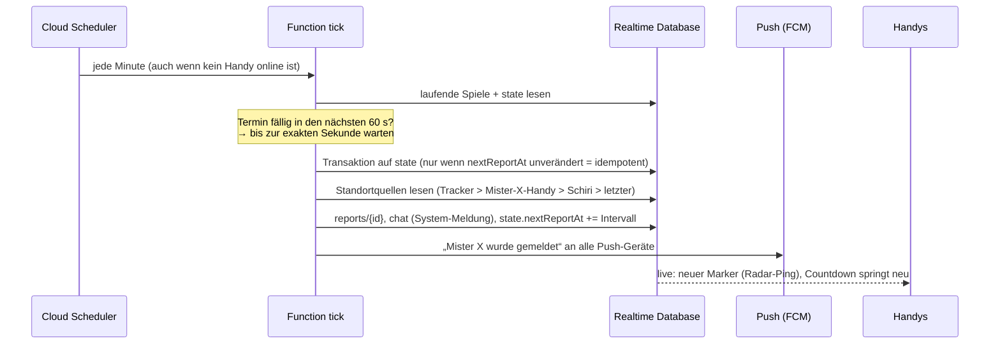
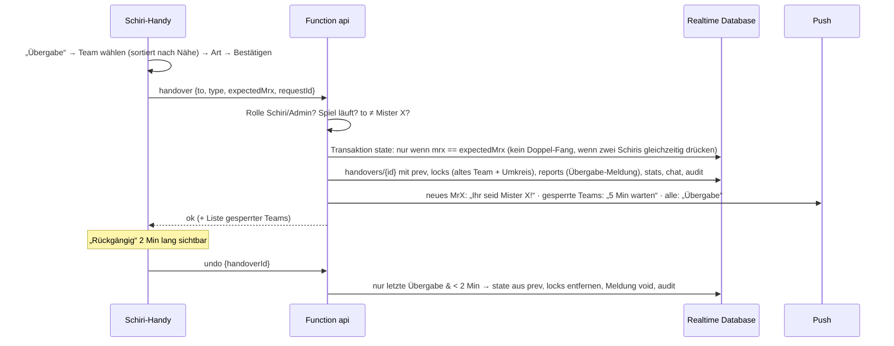
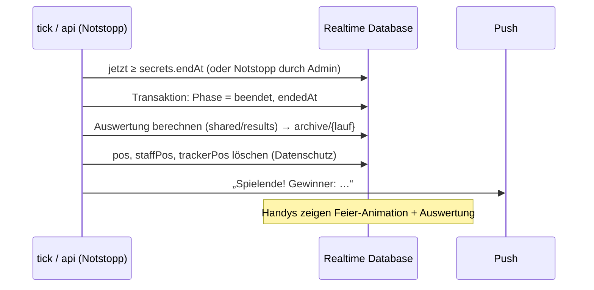

# Konzept: Neubau „Mister X – Rote Falken“

Stand: Meilenstein 1 (Analyse & Konzept) + Design-Prototyp. **Wartet auf Bestätigung durch den Organisator.**
Begründungen zu allen Entscheidungen: [`ENTSCHEIDUNGEN.md`](ENTSCHEIDUNGEN.md). Offene Fragen: [Abschnitt 9](#9-offene-fragen-bitte-beantworten).

---

## 1. Was der Prototyp lehrt (Analyse des Ist-Stands)

| Thema | Prototyp (`app.js`, 540 Zeilen) | Problem | Neubau |
|---|---|---|---|
| Spiel-Logik | läuft im Browser (`tick()` jede Sekunde, Transaktion auf `reports/{slot}`) | Sind Admin- und Mister-X-Handy offline, passiert nichts. Zufallsende nur, wenn Admin-Handy offen ist. | **Server-Autorität**: Cloud Functions + minütlicher Takt |
| Geheimnisse | `secret/teamPw` im Klartext, Admin liest es; Admin-Konto = „wer zuerst kommt“ | Passwort im Klartext, Admin-Übernahme beim ersten Aufruf möglich | Passwörter **gehasht** (scrypt), nur Functions lesen `/secrets`; Super-Admin per Google-Login + Freigabeliste |
| Rechte | Rules prüfen Rolle, aber `game`, `handovers`, `locks` sind für **jeden Schiri** frei beschreibbar | Ein Schiri-Handy kann das Spiel beliebig verändern | Spielzustand ist **nur** für Functions schreibbar; Clients senden Aktionen |
| Standort | `watchPosition` nur bei offenem Bildschirm, alle 15 m / 30 s | Hintergrund unmöglich | Android-App mit Foreground-Service; Web wie bisher + Wake Lock |
| Distanz | Handy zählt selbst und schreibt `stats/dist` | manipulierbar, GPS-Sprünge zählen mit | Server zählt aus aufeinanderfolgenden Punkten (Plausibilität) |
| Spielfeld | fest in `zones.js`, Toleranz über 8 Prüfpunkte | nur Linz, Näherung bis 1,5 m | Spielfeld pro Spiel in der Datenbank, Toleranz auf 0,4 m genau, exakter Abstand zur Grenze für Warnungen; **Linz-Polygone 1:1 übernommen** |
| Schiris | melden sich als Team an, Admin befördert | umständlich, Schiri erscheint kurz als Team | eigener **Schiri-Code** |
| Benachrichtigung | Ton + Vibration nur bei offener Seite | nichts bei gesperrtem Handy | FCM-Push (Android-App, PWA) + In-App-Ton |

**Übernommen werden die Abläufe**, die sich bewährt haben: Team-Login mit gemeinsamem Team-Passwort, Übergabe mit
Umkreis-Wartezeit, Rückgängig, Strafübergabe, Sofort-Meldung, Durchsage, Offline-Warnung nach 3 Min, Zufallsende-Fenster,
Notstopp, Auswertung (4 Kategorien), Archiv mit Mister-X-Route + Chat, „Neue Runde vorbereiten“, Großbild.
Die E2E-Szenarien aus `test/e2e.js` und die Zonen-Prüfpunkte aus `test/zones.test.mjs` werden 1:1 als Testfälle weitergeführt.

---

## 2. Architektur im Überblick



**Grundprinzip:** Handys *lesen* den Spielzustand live aus der Datenbank und *schreiben* nur zwei Dinge direkt:
ihren eigenen Standort und normale Chat-Nachrichten (beides durch Security Rules streng geprüft).
**Alles Spielentscheidende** (Start, Meldungen, Übergabe, Wartezeiten, Sperrbereiche, Ende, Auswertung) passiert in den
Cloud Functions. Ein Handy kann eine Aktion *anfragen* („Übergabe an Team B“), der Server prüft Rolle, Zustand und Zeit
und führt sie aus – oder lehnt sie ab.

### 2.1 Bausteine

| Baustein | Technik | Aufgabe |
|---|---|---|
| **App** | TypeScript (strict), Svelte 5, Vite, MapLibre GL, PWA (Service Worker) | Eine Codebasis für Web und Android |
| **Android-Hülle** | Capacitor 8, `@capacitor-community/background-geolocation`, `@capacitor/push-notifications` | Hintergrund-Standort mit Dauer-Benachrichtigung, Push |
| **Spiel-Server** | Cloud Functions 2nd gen (Node 22), Region `europe-west1` (gleich wie die Datenbank) | `api` (eine aufrufbare Funktion für alle Aktionen), `tick` (jede Minute), `onPosition` (Plausibilität, Distanz, Spielfeld-Warnung), `tracker` (HTTP), `cleanup` (täglich) |
| **Datenbank** | Realtime Database (`europe-west1`, besteht schon) | Live-Zustand, Standorte, Chat, Archiv |
| **Login** | Firebase Auth: *anonym* für Teams/Schiris/Spiel-Admins (+ serverseitig geprüftes Passwort), *Google* für Super-Admin | keine E-Mail-Konten für Kinder/Jugendliche nötig |
| **Push** | FCM (Android-App, Web-Push; iPhone nur als installierte PWA ab iOS 16.4) | Meldung, Übergabe, Wartezeit, Durchsage … |
| **Karte** | MapLibre GL + OpenFreeMap-Vektorkacheln, **eigener Kartenstil** (hell/dunkel/Sonne) | kostenlos, ohne Schlüssel, ohne Tracking; Fallback OSM-Raster |
| **Gemeinsamer Code** | `shared/` – reine TypeScript-Module ohne Firebase | Meldeplan, Geometrie/Zonen, Wartezeit-Umkreis, Standortquellen, Auswertung, Texte, Typen. Von App **und** Functions genutzt, mit Unit-Tests |

### 2.2 Ordnerstruktur (Monorepo mit npm-Workspaces)

```
shared/      reine Spiel-Logik + Typen + Linz-Vorlage (getestet mit Vitest)
app/         Svelte-App (Web + Android via Capacitor, Ordner app/android/)
  src/ui/        Komponenten-Bibliothek (Design-System)
  src/screens/   die 23 Screens
  src/map/       Karte + Kartenstile
  src/lib/       Firebase, Standort, Push, Ton, Zeit
  src/texte.ts   alle Texte zentral
functions/   Cloud Functions (TypeScript, gebündelt mit esbuild)
tests/       Rules-Tests, Function-Tests (Emulator), E2E (Playwright), Lasttest
docs/        Konzept, Entscheidungen, Handbücher, Screenshots
legacy/      alter Prototyp (nur Referenz; die Live-Version bleibt bis zur Abnahme auf dem Haupt-Branch)
```

---

## 3. Rollen, Zugang, Rechte

### 3.1 Wie man in ein Spiel kommt

| Rolle | Zugang | Technisch |
|---|---|---|
| **Super-Admin** | „Mit Google anmelden“ (z. B. `mr.x.rf.ooe@gmail.com`) | Google-Login; Function prüft E-Mail gegen Freigabeliste (Deploy-Parameter `SUPER_ADMINS`) und setzt **Custom Claim** `superAdmin` |
| **Spiel-Admin** | Spiel-Code + Name + **Admin-Passwort** (vom Super-Admin pro Spiel vergeben) | anonymes Konto + Function `join` prüft Passwort-Hash → Eintrag `members/{uid} = admin` |
| **Schiri** | Spiel-Code + Name + **Schiri-Code** | wie oben, Rolle `schiri` |
| **Team** | QR-Code/Link (enthält Spiel-Code) + Teamname + **Team-Passwort** | wie oben, Rolle `team`; ein zweites Handy kann demselben Team beitreten (Ersatzgerät) |
| **Großbild** | Link mit Großbild-Schlüssel (Admin zeigt QR) | Rolle `screen`: sieht alles wie Admin, darf nichts ändern |
| **Zuschauer** (optional, pro Spiel einschaltbar) | öffentlicher Zuschauer-Link | Rolle `viewer`: nur Mister-X-Meldungen + Ereignisse, **keine** Live-Positionen, kein Chat |

`members/{uid}` schreibt **ausschließlich** der Server. Die Security Rules lesen daraus die Rolle.
Mehrere Spiel-Admins pro Spiel sind möglich (jeder mit eigenem Namen → im Protokoll nachvollziehbar).
Fehlversuche beim Beitritt werden pro Gerät **und** pro IP gezählt (max. 5 in 10 Min).

### 3.2 Rechte-Matrix (durchgesetzt in Security Rules **und** Functions, automatisiert getestet)

| Daten / Aktion | Team | Mister-X-Team | Schiri | Spiel-Admin | Großbild | Zuschauer | Super-Admin |
|---|---|---|---|---|---|---|---|
| Spielzustand, Meldungen, Übergaben, Wartezeiten lesen | ✔ | ✔ | ✔ | ✔ | ✔ | ✔ | ✔ |
| **Live-Positionen** (`pos`, `staffPos`, `trackerPos`) lesen | ✖ | ✖ | ✔ | ✔ | ✔ | ✖ | ✔ |
| eigenen Standort schreiben | ✔ (nur eigenes Team) | ✔ | ✔ | optional | – | – | – |
| Gruppenchat lesen/schreiben | ✔ / ✔ | ✔ / ✔ | ✔ / ✔ | ✔ / ✔ | ✔ / ✖ | ✖ | ✔ |
| Direktkanal | nur eigener | nur eigener | ✖ | alle | ✖ | ✖ | alle |
| System-Meldung / Durchsage erzeugen | ✖ | ✖ | ✖ | Durchsage ✔ | ✖ | ✖ | ✔ |
| Übergabe, Strafübergabe, Rückgängig, Wartezeit setzen | ✖ | ✖ | ✔ | ✔ | ✖ | ✖ | ✔ |
| Start, Pause, Notstopp, Regeln, Sperrbereiche, Zufallsende aufdecken | ✖ | ✖ | ✖ | ✔ | ✖ | ✖ | ✔ |
| Passwörter/Codes, Teams & Schiris verwalten, Neue Runde, Protokoll lesen | ✖ | ✖ | ✖ | ✔ | ✖ | ✖ | ✔ |
| Spiele anlegen/archivieren/löschen, Spiel-Admin-Passwort | ✖ | ✖ | ✖ | ✖ | ✖ | ✖ | ✔ |

Lesezugriffe werden in der Realtime Database **nur auf Blatt-Ebene** vergeben (z. B. `games/{id}/reports`), nie auf
`games/{id}` – sonst würden die Rules die Positionen über den Eltern-Knoten freigeben. Genau dieser „Datenbank-Trick“
wird im Rule-Test geprüft (lesen von `/`, `/games`, `/games/{id}`, `/games/{id}/pos`, `/secrets` als Team → verweigert).

---

## 4. Datenmodell (Realtime Database)

`{g}` = Spiel-Code (z. B. `linz-2027`), `{t}` = Team-ID, `{uid}` = Firebase-Konto eines Geräts.
Spalte **schreibt**: *F* = nur Functions, *C* = Client (mit Rules-Prüfung).

| Pfad | Inhalt | liest | schreibt |
|---|---|---|---|
| `games/{g}/info` | Name, Ort, Phase (`vorbereitung`, `laeuft`, `pause`, `beendet`), Zuschauer erlaubt? | alle Mitglieder | F |
| `games/{g}/config` | `intervalMin` (10), `headStartMin` (10), `waitMin` (5), `radiusM` (200), `toleranceM` (20), `undoMin` (2), `endMinH`/`endMaxH` (3/4), Regeltext | Mitglieder | F |
| `games/{g}/field` | Spielfeld-Polygon + Sperrbereiche `{id: {name, farbe, reihenfolge, polygon}}` | Mitglieder | F |
| `games/{g}/state` | `mrx`, `mrxSince`, `startedAt`, `pausedAt`, `lastReportAt`, `nextReportAt`, `cuts` (gesperrte Bereiche), `rev` | Mitglieder | F |
| `games/{g}/members/{uid}` | Rolle, Team-ID, Name, `followsFlag` (Schiri folgt der Fahne) | Admin; jeder seinen eigenen | F |
| `games/{g}/teams/{t}` | Name, Kürzel (2 Buchstaben), Farbe | Mitglieder | F |
| `games/{g}/pos/{t}` | `lat, lng, acc, t, uid, heading?, akku?, suspect?` | Admin, Schiri, Großbild | C (nur Mitglied von `{t}`) |
| `games/{g}/staffPos/{uid}` | Standort von Schiris | Admin, Schiri, Großbild | C (nur eigener) |
| `games/{g}/trackerPos/{gerät}` | Tracker-Positionen | Admin, Schiri, Großbild | F |
| `games/{g}/reports/{id}` | Mister-X-Meldung: Team, Ort, `posAt`, `t`, Quelle (`handy`/`tracker`/`schiri`/`letzter`), Art (`auto`/`sofort`/`uebergabe`), `void` | Mitglieder | F |
| `games/{g}/handovers/{id}` | `from, to, at, type (start/fang/strafe), by, ort, prev (für Rückgängig), undoneAt` | Mitglieder | F |
| `games/{g}/locks/{t}` | `until`, Grund (Start/Übergabe/manuell) | Mitglieder | F |
| `games/{g}/stats/{t}` | Distanz (m), Zeit als Mister X, Anzahl | Mitglieder | F |
| `games/{g}/chat/{id}` | `uid, name, text, t, kind (msg/sys/ann), ev (Verweis auf Meldung)` | Mitglieder außer Zuschauer | C nur `kind=msg` (Länge ≤ 300, max. 1 Nachricht / 2 s); F für `sys`/`ann` |
| `games/{g}/dm/{t}/{id}` | Direktkanal Team ↔ Admin | Admin + Team `{t}` | C (Admin oder Team `{t}`) |
| `games/{g}/audit/{id}` | Protokoll: wer, wann, was | Admin | F |
| `games/{g}/devices/{gerät}` | Tracker: Name, Zuordnung (`team:{t}` oder `fahne`), zuletzt gesehen | Admin | F |
| `games/{g}/push/{uid}` | FCM-Token, Plattform, gewählte Push-Arten | eigener | C (nur eigener) |
| `games/{g}/archive/{lauf}` | Auswertung, Übergaben, Mister-X-Meldungen, Chat, Teamnamen, Protokoll | Mitglieder | F |
| `secrets/{g}` | Passwort-Hashes (Admin/Schiri/Team), Großbild-Schlüssel, **Spielende-Zeitpunkt**, Tracker-Tokens | **niemand** | F |
| `userGames/{uid}` | in welchem Spiel ist dieses Gerät (für „angemeldet bleiben“) | eigener | F |
| `gameIndex/{g}` | Liste aller Spiele für Super-Admin | Super-Admin | F |

**Bewusst nicht gespeichert:** lückenlose Bewegungsprofile. `pos` enthält immer nur den **letzten** Standort pro Team.
Die Distanz wird beim Eintreffen jedes neuen Punkts serverseitig aufsummiert (`onPosition` bekommt alten und neuen Wert),
ohne die Spur zu speichern. Nur Mister-X-*Meldungen* (die ohnehin alle gesehen haben) kommen ins Archiv.

---

## 5. Spielregeln → Umsetzung (Server)

Die Nummern verweisen auf das Original-Regelblatt (`PROMPT-NEUBAU.md`, Abschnitt 1). Alle Zeiten sind **Server-Zeit**;
die Handys rechnen ihren Countdown mit dem gemessenen Zeitversatz zum Server (`.info/serverTimeOffset`).

| # | Regel | Umsetzung |
|---|---|---|
| 1, 2 | Mister X startet zuerst, nach 10 Min Meldung, dann laufen alle los | Start: `mrx` gesetzt, **Startsperre** (`locks`) für alle Jäger bis `startedAt + headStartMin`; erste Meldung genau dann |
| 3, 4 | Tapperl → Übergabe; altes Team + Teams in der Nähe warten 5 Min | `api: handover` (nur Schiri/Admin). Übergabeort = Standort des neuen Mister X (Fallback: alter Mister X, Schiri). Gesperrt: altes Team + alle Teams mit **frischem** Standort im Umkreis `radiusM`; der neue Mister X nie. Sofort eine Meldung („Übergabe-Meldung“), nächste automatische Meldung nach `intervalMin` |
| 5 | Meldung alle 10 (später 5) Min | `nextReportAt = lastReportAt + intervalMin`. Bei Intervalländerung: `max(lastReportAt + neu, jetzt + 1 Min)` → Mister X hat immer mind. 1 Min Vorwarnung |
| 7, 9 | nicht in Gebäuden / Grenzstraßen gehören dazu | Spielfeld mit Toleranz (`toleranceM`, Standard 20 m; Prüfung über 32 Punkte im Kreis, auf 0,4 m genau). Abstand zur Grenze für die Mister-X-Warnung exakt. Gebäude prüft die App nicht (Schiri) |
| 10 | Verkleinerung | `api: setCuts` → Bereich gesperrt, System-Meldung + Push „Der Norden wird gesperrt!“ |
| 11, 13 | Schiri/Admin entscheidet, Strafübergabe | `api: handover` mit `type: strafe`; Spielfeld-Warnung geht an Mister X + Schiri + Admin, Konsequenz entscheidet der Mensch |
| 12 | Wer am Ende Mister X ist, gewinnt | Zufallszeitpunkt gleichverteilt in `[Start + endMinH, Start + endMaxH]`, nur in `secrets/` gespeichert; `tick` beendet das Spiel |
| – | Rückgängig | nur die **letzte** Übergabe, nur innerhalb `undoMin` (2 Min), stellt `mrx`, `mrxSince`, `nextReportAt` aus `prev` wieder her, entfernt die dadurch gesetzten Wartezeiten, markiert die Übergabe-Meldung als `void` |
| – | Sofort-Meldung (Strafe) | zusätzliche Meldung, Meldeplan läuft unverändert weiter |
| – | Pause (Vorschlag) | friert Meldeplan, Wartezeiten und Spielende ein; beim Fortsetzen werden alle Zeiten um die Pausendauer verschoben |

**Standortquelle für Meldungen und Umkreis** (eine gemeinsame Funktion in `shared/`, von Server und Karte genutzt):
1. Tracker, der „der Fahne“ zugeordnet ist (wenn jünger als 2 Min)
2. Mister-X-Gerät (jünger als 2 Min)
3. Schiri, der der Fahne folgt (jünger als 2 Min)
4. sonst der **letzte bekannte** Standort aus 1–3 → Meldung zeigt „letzter bekannter Standort von 14:32“

Jede Meldung speichert ihre Quelle; die App zeigt sie transparent an („Standort vom Schiri“).

**Plausibilität (`onPosition`):** Punkte mit Genauigkeit > 50 m zählen nicht zur Distanz; Sprünge mit > 25 m/s
(90 km/h) werden als `suspect` markiert und weder für Distanz noch für Umkreis-Wartezeit verwendet; Bewegungen < 10 m
gelten als GPS-Rauschen.

---

## 6. Abläufe

### 6.1 Automatische Mister-X-Meldung



Ein minütlicher Takt plus „warten bis zur Sekunde“ ergibt sekundengenaue Meldungen ohne Cloud Tasks.
Zwei überlappende Läufe sind harmlos, weil jede Änderung als Transaktion mit erwartetem Zustand läuft.

### 6.2 Übergabe (Fang) und Rückgängig



Netzabbruch während der Übergabe: Die App wiederholt die Anfrage mit derselben `requestId`; der Server erkennt sie und
führt nichts doppelt aus.

### 6.3 Spielende



### 6.4 Beitritt per QR-Code

QR-Code → `https://mr-x-ooe.web.app/#/s/linz-2027` → Startseite mit vorausgefülltem Spiel → Teamname + Team-Passwort →
`api: join` → Onboarding (Standort, Benachrichtigungen, Akku, Regeln kurz) → Warteraum. Das Gerät merkt sich das Spiel;
wird das Team entfernt oder eine neue Runde vorbereitet, landet das Gerät mit einer freundlichen Erklärung auf der Startseite.

---

## 7. Standort, Akku, schlechtes Netz

- **Senderhythmus (adaptiv):** Mister X alle 10 s oder bei > 15 m Bewegung; Jäger und Schiris alle 15 s / > 15 m;
  vor Spielstart jede Minute; nach Spielende gar nicht. Punkte mit Genauigkeit > 100 m werden gekennzeichnet.
- **Android-App:** Foreground-Service mit Dauer-Benachrichtigung „Mister X läuft – Standort wird geteilt“,
  Berechtigungen `ACCESS_FINE_LOCATION`, `ACCESS_BACKGROUND_LOCATION`, `FOREGROUND_SERVICE_LOCATION`,
  `POST_NOTIFICATIONS`, Bitte um Ausnahme von der Akku-Optimierung (mit Schritt-für-Schritt-Hilfe im Onboarding).
- **iPhone (ehrlich):** Safari/PWA sendet **keinen** Standort, wenn der Bildschirm aus ist oder eine andere App offen ist.
  Lösung im Spiel: Bildschirm anlassen (Wake Lock), Powerbank. Push funktioniert nur, wenn die Web-App zum
  Home-Bildschirm hinzugefügt wurde (ab iOS 16.4). Für Mister X fängt der Schiri-Fallback Lücken auf.
- **Offline:** Firebase puffert Schreibvorgänge; die App zeigt „Offline – letzte Daten von 14:32“. Aktionen (Übergabe)
  sind idempotent. Die Kartenkacheln des Spielfelds werden beim Beitritt vorgeladen (≈ 30 Kacheln, erlaubt laut
  OpenFreeMap-Nutzungsbedingungen), damit die Karte auch in Unterführungen da ist.
- **Akku:** kein Dauer-Neuzeichnen (Svelte aktualisiert nur geänderte Stellen), Countdown-Animation per CSS,
  Karte zeichnet nur bei Datenänderung neu.

---

## 8. Kostenabschätzung (Blaze-Tarif)

Annahme pro Spiel: 30 Teams, 4 Schiris, 2 Admins, 1 Großbild, 4 Stunden; ein paar Spiele pro Jahr.

| Dienst | Verbrauch pro Spiel | Gratis-Kontingent | Kosten |
|---|---|---|---|
| Realtime Database – Download | ≈ 33 000 Standort-Updates × 7 Empfänger × ~250 B ≈ 60 MB + Chat/Meldungen/Neuverbindungen ≈ 60 MB → **≈ 120 MB** | 10 GB / Monat | 0 € |
| Realtime Database – Speicher | < 10 MB (keine Bewegungsprofile) | 1 GB | 0 € |
| Cloud Functions – Aufrufe | `onPosition` ≈ 33 000, `api` ≈ 1 000, `tick` 43 200 / Monat (jede Minute) | 2 Mio. / Monat | 0 € |
| Cloud Functions – Rechenzeit | `tick` wartet max. 60 s pro Minute → ≈ 4 h Instanzzeit pro Spiel ≈ 2 400 vCPU-s, 3 600 GiB-s | 180 000 vCPU-s, 360 000 GiB-s / Monat | 0 € |
| Cloud Scheduler | 2 Jobs (`tick`, `cleanup`) | 3 Jobs pro Rechnungskonto | 0 € |
| Cloud Messaging (Push) | beliebig | unbegrenzt | 0 € |
| Hosting | App ≈ 0,5 MB × 50 Geräte = 25 MB; APK ≈ 8 MB × 30 = 240 MB (einmal pro Jahr) | 10 GB Speicher, 360 MB / Tag | 0 € (Spitze am APK-Tag ≤ 0,05 €) |
| Artifact Registry (Function-Images) | ≈ 0,3–1 GB | 0,5 GB | **≤ 0,10 € / Monat** – mit Aufräum-Regel (`firebase functions:artifacts:setpolicy`) praktisch 0 € |
| Authentication | ≈ 50 anonyme Konten / Spiel | 50 000 aktive Nutzer / Monat | 0 € |
| Kartenkacheln (OpenFreeMap) | ≈ 50 Geräte × 100 Kacheln | unbegrenzt, gratis | 0 € |

**Ergebnis: ≈ 0 € pro Monat** (schlimmstenfalls einige Cent). Empfehlung: **Budget-Alarm bei 5 €** mit E-Mail bei
50 %, 90 %, 100 % (Achtung: ein Budget-Alarm warnt nur, er stoppt nichts). Anleitung folgt in
`docs/FIREBASE-EINRICHTUNG.md` (Meilenstein 3), sobald der Blaze-Tarif gebraucht wird.

Der Lasttest (Meilenstein 12) misst diese Zahlen im Emulator nach und korrigiert die Tabelle.

---

## 9. Offene Fragen (bitte beantworten)

Zu jeder Frage steht der **Vorschlag**, mit dem ich weiterarbeite, falls keine andere Antwort kommt.

| # | Frage | Vorschlag |
|---|---|---|
| F1 | **Logos & Farben:** Gibt es die Logos als Vektor (SVG/PDF) oder größer? Rote-Falken-Logo mit transparentem Hintergrund? Nutzungsrechte für die App bestätigt? | Farben exakt aus den PNGs: Rote-Falken-Rot `#C51A1A`, Rote-Falken-Blau `#214C6B`; Kinderfreunde-Rot `#DC0219`, -Blau `#005CA8`. Bis Vektoren da sind: PNGs freigestellt, nur klein verwendet |
| F2 | **Pause-Funktion** (z. B. Regen)? | **Ja**: friert Meldungen, Wartezeiten und Spielende ein |
| F3 | **Aufbewahrung** Archiv / Chat? | Archiv (Meldungen, Übergaben, Auswertung) **1 Jahr**, Chat **30 Tage**, Live-Standorte **sofort bei Spielende** gelöscht |
| F4 | Sehen sich **Jäger-Teams gegenseitig** auf der Karte? | **Nein** (wie bisher) |
| F5 | Sieht **Mister X die Jäger**? | **Nein** (wie bisher) |
| F6 | **Zuschauer-/Eltern-Modus**? Was darf er zeigen? | Ja, pro Spiel einschaltbar: nur Mister-X-Meldungen, Übergaben, Spielfeld, Rangliste – **keine** Live-Positionen, kein Chat |
| F7 | Wer ist **Super-Admin**? Wie viele Spiel-Admins? | Super-Admin: `mr.x.rf.ooe@gmail.com` (Google-Login). Beliebig viele Spiel-Admins über das Admin-Passwort, jeder mit Namen |
| F8 | Soll der Start-Mister-X **ausgelost** werden können? | **Ja**, mit Los-Animation; alternativ direkt wählen |
| F9 | **Vorsprung am Start** = Meldeintervall oder eigener Wert? | eigener Wert `headStartMin`, Standard 10 Min |
| F10 | Nach einer Übergabe **sofort** den Standort des neuen Mister X melden? (`SPEC.md`: ja) | **Ja**, Übergabe-Meldung am Übergabeort |
| F11 | **Umkreis** für die Wartezeit nach Übergabe? | 200 m (wie Prototyp), live änderbar |
| F12 | **Datenschutz:** Wer ist „Verantwortlicher“ (Name, Adresse, Kontakt-E-Mail) für den Datenschutzhinweis? | Die Kinderfreunde OÖ – bitte Adresse/E-Mail nennen |
| F13 | **APK-Verteilung:** Das Repository ist privat → GitHub-Downloads brauchen ein Konto. | APK über Firebase Hosting ausliefern (`https://mr-x-ooe.web.app/app.apk`) + QR-Code |
| F14 | Darf ein Team ein **zweites Handy** (Ersatzgerät) anmelden? | **Ja**, gleiches Team-Passwort; das jeweils neueste Signal zählt |

---

## 10. Design-Konzept (Kurzfassung – Details im Klick-Prototyp)

**Leitidee „Fahndung in Rot-Weiß“:** dunkles Nacht-Blau (abgeleitet vom Rote-Falken-Blau) als Spielfläche, kräftiges
Rote-Falken-Rot für alles, was mit Mister X und Aktionen zu tun hat, Weiß für Lesbarkeit. Agenten-Elemente sparsam:
schmale, fette Großbuchstaben-Überschriften (wie Akten-Stempel), Radar-Ping bei Meldungen, gestrichelte Spur,
Ecken-Markierungen wie ein Fadenkreuz am Countdown. Wärme der Roten Falken: runde Formen, Fahne + Falke, freundliche
Sprache („Tapperl“, „Ihr seid Mister X!“).

- **Drei Darstellungen:** *Dunkel* (Standard im Spiel), *Hell*, **Sonne** (Hochkontrast: weißer Grund, schwarze Schrift,
  dicke Ränder, keine Transparenzen) – automatisch nach System, im Spiel mit einem Tipp umschaltbar.
- **Mister-X-Modus:** Rahmen + Statusleiste wechseln auf Rot, Fahnen-Symbol – sofort erkennbar, auch aus dem Augenwinkel.
- **Typografie:** *Barlow Condensed* (Überschriften, Countdown, tabellarische Ziffern) + *Inter* (Text), lokal
  eingebunden, Mindestgröße 16 px; Countdown 48–96 px.
- **Bedienung:** Touch-Ziele ≥ 48 px (wichtige ≥ 56 px), Hauptaktionen unten in der Daumenzone, gefährliche Aktionen
  rot umrandet + Bestätigung; Untere Navigation **Karte · Chat · Regeln · Mehr**.
- **Karte:** eigener MapLibre-Stil auf OpenFreeMap-Kacheln: gedämpfte Basiskarte, außerhalb des Spielfelds abgedunkelt,
  leuchtend rote Grenzlinie, gesperrte Bereiche schraffiert mit Namen, Straßennamen groß und kontrastreich.
- **Barrierefreiheit:** WCAG AA (Statusleiste AAA), nie Information nur über Farbe (immer Icon + Text),
  „Bewegung reduzieren“ wird respektiert.

Der **Klick-Prototyp** (Meilenstein 2) zeigt alle 23 Screens mit Testdaten in hell/dunkel/Sonne und ist bereits im
echten Technik-Stack gebaut – die Komponenten werden später direkt weiterverwendet.

---

## 11. Weiterer Plan

Nach Bestätigung von Konzept + Prototyp geht es in der Reihenfolge der Meilensteine 3–13 aus `PROMPT-NEUBAU.md` weiter.
Jeder Meilenstein endet lauffähig, getestet, committet und mit kurzem Bericht im Pull Request.
