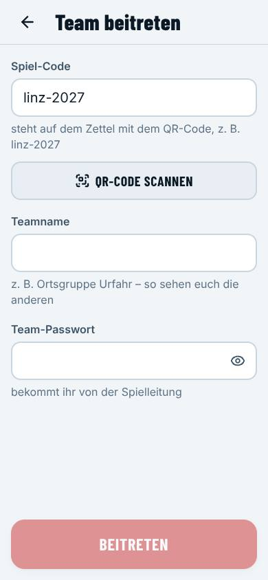
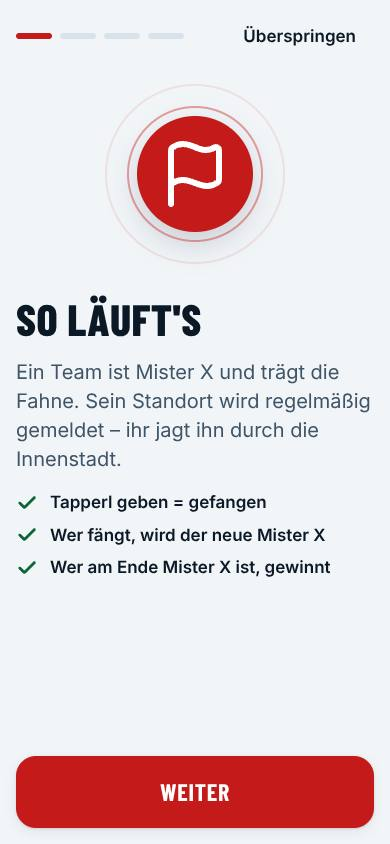
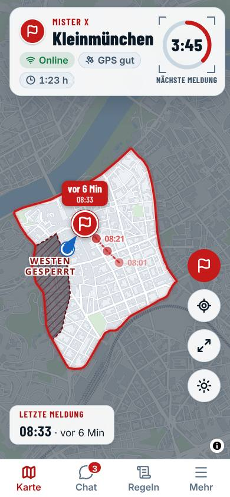
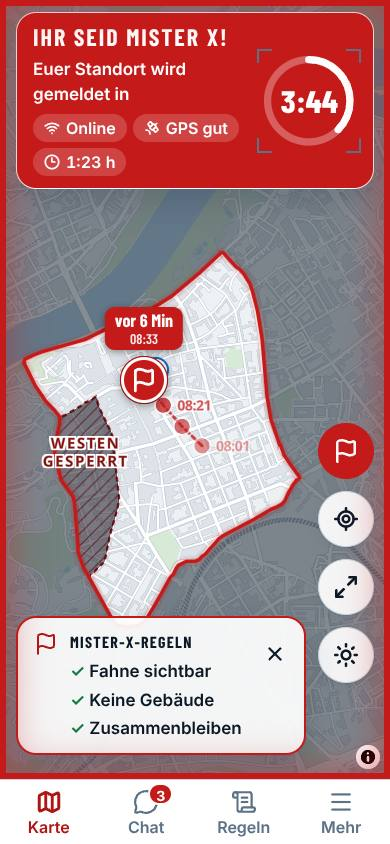

# Anleitung für Teams

So macht ihr bei **Mister X** mit. Den Flyer mit QR-Code und Team-Passwort bekommt ihr von der Spielleitung.

## Was ihr braucht

- **1–2 Handys pro Team** (Android oder iPhone) mit mobilem Internet. Ein zweites Handy ist praktisch, falls der Akku
  leer wird.
- Eine **Powerbank** – das Spiel dauert 3–4 Stunden.
- Euer **Halstuch** (gilt als Fahrschein in den Öffis).

## 1. App holen

### Android (empfohlen: App installieren)

Die Android-App sendet euren Standort auch, wenn das Handy in der Tasche ist und der Bildschirm aus ist.

1. QR-Code vom Flyer mit der Kamera scannen → im Browser tippt ihr auf **Android-App installieren**
   (oder ihr bekommt die Datei `mister-x.apk` von der Spielleitung).
2. Die Datei antippen. Android fragt **„Installation aus unbekannten Quellen zulassen?“** → für den Browser bzw.
   „Dateien“ **erlauben** → zurück → **Installieren**. (Die App kommt nicht aus dem Play Store, ist aber vom
   Organisator signiert.)
3. App **Mister X** öffnen → **Team beitreten** → den **Spiel-Code** vom Flyer eingeben.

Ohne Installation geht es auch im Browser – dann wie beim iPhone den Bildschirm anlassen.

### iPhone

1. QR-Code vom Flyer mit der Kamera scannen → die Seite öffnet sich in Safari.
2. Unten auf **Teilen** (Quadrat mit Pfeil) → **Zum Home-Bildschirm** → **Hinzufügen**.
3. Mister X **vom Home-Bildschirm aus** öffnen – nur so kommen Benachrichtigungen (ab iOS 16.4).
4. **Wichtig:** Am iPhone wird der Standort nur gesendet, solange die App offen und der Bildschirm an ist. Die App hält
   den Bildschirm von selbst wach – nicht sperren, Powerbank anstecken.

**Sprache:** Unten auf der Startseite (und später unter **Mehr → Einstellungen**) könnt ihr die Sprache wählen:
Deutsch, English, Türkçe oder Bosanski/Hrvatski/Srpski. Durchsagen und Chat-Nachrichten kommen so, wie sie geschrieben
wurden.

**Updates (Android-App):** Gibt es eine neue Version, zeigt die App **„Neue Version der App – Jetzt installieren“**.
Antippen, die Datei herunterladen und installieren – ihr bleibt angemeldet.

## 2. Beitreten

1. **Teamname** eingeben (z. B. „Ortsgruppe Urfahr“ – so sehen euch die anderen) und das **Team-Passwort** vom Flyer.
2. **Beitreten**.
3. Euer zweites Handy: denselben Teamnamen eingeben → **Als Ersatzgerät beitreten**.

## 3. Einmal einrichten (Onboarding)

1. **So läuft's** – kurz lesen.
2. **Standort erlauben** – die Spielleitung und die Schiris sehen, wo ihr seid (für Wartezeiten und eure Sicherheit).
   **Andere Teams sehen euch nicht.** Nach dem Spiel wird der Standort gelöscht.
3. **Benachrichtigungen erlauben** – damit ihr keine Meldung von Mister X und keine Durchsage verpasst.
4. **Akku** – Android-App: **Akku-Einstellungen öffnen** → „Nicht eingeschränkt“ bzw. „Nicht optimieren“ wählen.
   Sonst halten manche Handys (Samsung, Xiaomi, Huawei) die App nach ein paar Minuten an.

Danach seid ihr im **Warteraum**: dort seht ihr, ob Standort und Benachrichtigungen funktionieren („gut“), und die
wichtigsten Regeln.

## 4. Spielen

### Ihr jagt Mister X

- Nach dem Start wartet ihr den **Vorsprung** ab (Countdown).
- Die **Karte** zeigt die letzte Meldung von Mister X, seine Spur und euren eigenen Standort (blau). Oben steht, wann
  die **nächste Meldung** kommt.
- Gefangen ist Mister X, wenn ihr einer Person der Mister-X-Gruppe ein **Tapperl** gebt. Der Schiri trägt die
  Übergabe ein – ihr seid dann der **neue Mister X**.
- Wer bei einer Übergabe in der Nähe ist, muss kurz **warten** (rotes Fenster mit Countdown – bitte stehen bleiben).

### Ihr seid Mister X

- Die App wird **rot**. Euer Standort wird alle paar Minuten an alle gemeldet.
- Tragt die Fahne sichtbar, bleibt zusammen, geht in keine Gebäude.
- Die App warnt, wenn ihr der **Spielfeldgrenze** nahe kommt oder draußen seid.

### Weitere Knöpfe

- **Chat**: mit allen schreiben oder direkt mit der Spielleitung (z. B. „Akku fast leer“).
- **Regeln**: alle Spielregeln zum Nachlesen, mit Suche.
- **Mehr**: Einstellungen (Ton, Vibration, Benachrichtigungen), **Sonnen-Modus** für grelles Licht, Abmelden.
- Das ☀-Symbol auf der Karte schaltet schnell auf den Sonnen-Modus (sehr starker Kontrast).

## 5. Spielende

Das Spiel endet zu einem geheimen Zeitpunkt. Alle sehen die **Auswertung**: Wer am Ende Mister X ist, **gewinnt**.
Ab dann sendet die App **keinen Standort mehr**.

## 6. Datenschutz in Kürze

Wir speichern nur, was das Spiel braucht: Teamname, Chat und euren Standort während des Spiels. Live-Standorte sehen
nur Spielleitung und Schiris; sie werden bei Spielende gelöscht. Der Chat wird nach 30 Tagen gelöscht, die Auswertung
nach einem Jahr. Kein Tracking, keine Werbung. Den vollständigen Hinweis findet ihr in der App unter
**Regeln → Datenschutz**.

## 7. Wenn etwas nicht klappt

| Problem | Lösung |
|---|---|
| „Das Passwort stimmt nicht“ | Groß-/Kleinschreibung prüfen, bei der Spielleitung nachfragen |
| „Team gibt es schon“ | Das ist euer Team? → **Als Ersatzgerät beitreten**. Sonst anderen Namen wählen |
| Warteraum zeigt „Standort: nicht erlaubt“ | Android: Einstellungen → Apps → Mister X → Berechtigungen → Standort erlauben. iPhone: Einstellungen → Datenschutz → Ortungsdienste → Safari-Websites bzw. Mister X → „Beim Verwenden“ |
| „Kein Netz“ oben auf der Karte | weitergehen – die App verbindet sich von selbst neu und schickt dann alles nach |
| Keine Benachrichtigungen (iPhone) | App vom **Home-Bildschirm** öffnen, unter **Mehr** Benachrichtigungen erlauben |
| App hält im Hintergrund an (Android) | Akku-Optimierung ausschalten (Onboarding Schritt 4); die Dauer-Benachrichtigung nicht wegwischen |
| Handy kaputt oder Akku leer | anderes Handy: gleicher Teamname → **Als Ersatzgerät beitreten** |
| „Ihr wurdet abgemeldet“ | Die Spielleitung hat eine neue Runde vorbereitet – einfach neu beitreten |
